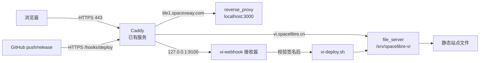
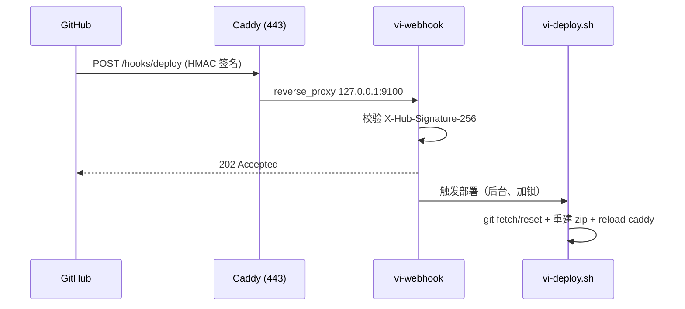

# 部署说明 · vi.spacelibre.cn

把本仓库部署为静态站点，并通过已有的 Caddy 以 `https://vi.spacelibre.cn/`（443）对外访问。

## 一、项目性质（为什么要这样部署）

- 本项目是**纯静态站点**：`index.html` + `styles.css` + `app.js` + `svg-sources.js` 及
  `01-logos/ … 07-palettes/`、`icons/` 等资源目录。
- `README.md` 明确说明“网页本身无需 Node 服务”；`package.json` 里的 `test/check/build`
  仅用于校验与打包，不是运行时依赖。
- 所有资源均用相对路径引用，可直接把**仓库根目录**当站点根目录托管。
- 唯一需要“构建”的产物是被 `.gitignore` 忽略的 `spacelibre-svg-assets.zip`
  （首页“下载全部 SVG”按钮指向它）。脚本会用 `scripts/build_artifacts.py`（仅 Python 标准库）
  重新生成，因此服务器上需要 `python3`。

结论：**用 Caddy 直接 `file_server` 提供静态文件即可**，不需要像 tile1 那样反代到某个端口。

## 二、目标架构



- Caddy 全局监听 80/443；对每个站名自动申请并续期 Let's Encrypt 证书。
- `vi.spacelibre.cn` 采用 `file_server`（无后端端口）；`tile1.spacexway.com` 的原有配置**保持不变**。
- 脚本以 `managed` 标记块的方式增删自己的站点块，幂等，可反复运行用于更新。

## 三、文件

| 文件 | 作用 |
| --- | --- |
| `deploy.sh` | 服务端安装脚本（在 VPS 上以 root 运行，幂等） |
| `one-click.sh` | 本地一键包装：SSH 到 VPS 后执行 `deploy.sh` |
| `vi-webhook.py` | GitHub Webhook 接收器（校验 HMAC 签名后触发部署） |
| `Caddyfile.vi.spacelibre.cn` | 追加到 Caddyfile 的站点块参考 |

## 四、使用方式

### 方式 A：本地一键（推荐）

在项目根目录执行：

```sh
# 在 VPS 上从 GitHub 克隆/更新
VPS_PASSWORD='你的服务器密码' bash deploy/one-click.sh

# 或：上传当前本地目录（仓库私有、或改动尚未推送时）
VPS_PASSWORD='你的服务器密码' MODE=local bash deploy/one-click.sh
```

`one-click.sh` 会用 `sshpass`（需本机安装）非交互登录；若未安装 `sshpass`，请不要设置
`VPS_PASSWORD`，脚本会回退到交互式 ssh，由你手动输入密码。

### 方式 B：在 VPS 上直接运行

```sh
# 把 deploy.sh 拷到服务器后
DOMAIN=vi.spacelibre.cn bash deploy.sh

# 或本地一行（交互输入密码）
ssh root@176.122.165.41 'bash -s' < deploy/deploy.sh
```

### 可覆盖的变量（环境变量）

| 变量 | 默认值 | 说明 |
| --- | --- | --- |
| `DOMAIN` | `vi.spacelibre.cn` | 对外域名 |
| `REPO_URL` | `https://github.com/spacelibres/vi.git` | 源仓库 |
| `REPO_BRANCH` | `main` | 分支 |
| `APP_DIR` | `/srv/spacelibre-vi` | 站点根目录 |
| `CADDYFILE` | `/etc/caddy/Caddyfile` | Caddy 配置 |
| `BUILD_ZIP` | `1` | 是否生成 SVG 合集 zip |
| `SETUP_FIREWALL` | `1` | 是否尝试放行 80/443 |
| `ACME_EMAIL` | 空 | 可选，证书通知邮箱 |
| `FORCE` | `0` | 允许清理已存在的非空 `APP_DIR` |
| `WEBHOOK_ENABLE` | `0` | 设为 `1` 安装 GitHub Webhook 接收器并开启自动部署 |
| `WEBHOOK_PATH` | `/hooks/deploy` | 对外 Webhook 路径 |
| `WEBHOOK_PORT` | `9100` | 接收器监听端口（仅 `127.0.0.1`） |
| `WEBHOOK_SECRET` | 空 | Webhook 密钥；留空则自动生成 |

## 五、脚本做了什么（幂等）

1. 安装依赖：`git`、`curl`、`python3`（按需）。
2. 确认 `caddy` 存在（缺失时尝试官方源安装）。
3. 克隆或更新仓库到 `APP_DIR`（浅克隆，`git fetch` + `reset --hard FETCH_HEAD`）。
4. 生成 `spacelibre-svg-assets.zip`。
5. 设置权限（确保 `caddy` 用户可读）。
6. 重写 Caddyfile 中的托管块（先备份，`caddy fmt` + `caddy validate`，失败自动回滚）。
7. `systemctl reload caddy`。
8. 放行防火墙 80/443（如启用 ufw/firewalld）。
9. DNS 预检：核对 `vi.spacelibre.cn` 的 A 记录是否指向本机公网 IP（仅提示）。

## 六、部署前你需要做的两件事

1. **DNS**：在域名服务商处添加 `A vi.spacelibre.cn → 176.122.165.41`
   （若走 CDN 则指向 CDN 提供的地址）。DNS 未生效时 Caddy 无法完成 ACME 校验。
2. **端口**：确保 80 与 443 在安全组/防火墙对公网开放（脚本会尝试放行本机防火墙）。

> 首次访问若证书报错，多为 DNS 尚未生效或 80/443 被拦截；修正后 Caddy 会自动重试签发。

## 七、GitHub Webhook 自动部署（可选）

开启后，向 `spacelibres/vi` 推送 `main`（或推送 `v*` 标签、发布 Release）会**自动同步**到 VPS。



### 启用

在部署时加上 `WEBHOOK_ENABLE=1`（密钥留空自动生成）：

```sh
WEBHOOK_ENABLE=1 bash deploy/deploy.sh
```

脚本会安装以下内容：

| 路径 | 说明 |
| --- | --- |
| `/usr/local/bin/vi-webhook.py` | 接收器脚本 |
| `/usr/local/sbin/vi-deploy.sh` | 稳定版部署脚本（供 webhook 调用） |
| `/etc/default/vi-deploy` | 部署环境变量 |
| `/etc/vi-webhook.env` | 接收器 env（含密钥，`0600`） |
| `/etc/systemd/system/vi-webhook.service` | 服务单元（仅监听回环；`KillMode=process`） |

并在 Caddy 站点块中加入 `@viwebhook path /hooks/deploy` → `reverse_proxy 127.0.0.1:9100`。

### 在 GitHub 创建 Webhook

方式一（界面）：仓库 Settings → Webhooks → Add webhook

- Payload URL：`https://vi.spacelibre.cn/hooks/deploy`
- Content type：`application/json`
- Secret：部署时打印的 Secret
- Events：`Just the push event`（如需按发布触发，选 `Let me select individual events` 勾选 `Releases`）

方式二（一键，需写权限的 token）：

```sh
GH_TOKEN=<token> gh api repos/spacelibres/vi/hooks -X POST \
  -f name=web -F active=true \
  -f 'events[]=push' -f 'events[]=release' \
  -f 'config[url]=https://vi.spacelibre.cn/hooks/deploy' \
  -f 'config[content_type]=json' \
  -f 'config[secret]=<SECRET>' \
  -f 'config[insecure_ssl]=0'
```

### 触发规则

| 事件 | 条件 | 是否部署 |
| --- | --- | --- |
| `push` | `refs/heads/main` | ✅ |
| `push` | `refs/tags/v*` | ✅ |
| `release` | `action = published` | ✅ |
| `ping` | — | 返回 200（仅握手） |
| 其它 | — | 忽略（200） |

### 安全性与可靠性

- 接收器仅绑定 `127.0.0.1:9100`，只能经 Caddy 访问；所有请求必须携带正确的 `X-Hub-Signature-256`，否则 `401`。
- 部署在后台线程执行，并用 `flock /var/lock/vi-deploy.lock` 串行化；并发触发会被安全跳过。
- 服务单元用 `KillMode=process`，重启服务不会中断正在进行的部署。
- `/usr/local/sbin/vi-deploy.sh` 仅在仓库版本通过 `bash -n` 语法校验后才替换，避免坏提交锁死自动部署。
- Webhook 密钥保存在 `/etc/vi-webhook.env`（`0600`）；重复运行或自动部署会**沿用**已有密钥（仅首次生成），不会打断 GitHub 校验。查看：`grep VI_WEBHOOK_SECRET /etc/vi-webhook.env`。

### 排查

```sh
systemctl status vi-webhook        # 服务状态
journalctl -u vi-webhook -f        # 接收器日志（含每次部署输出）
git -C /srv/spacelibre-vi log --oneline -3   # 当前部署的提交
```

## 八、更新与回滚

- **更新**：再次运行脚本即可（拉取最新代码并重载 Caddy）。
- **回滚代码**：`git -C /srv/spacelibre-vi reset --hard <commit>`。
- **回滚 Caddy 配置**：`cp /etc/caddy/Caddyfile.bak.<时间戳> /etc/caddy/Caddyfile && systemctl reload caddy`。
